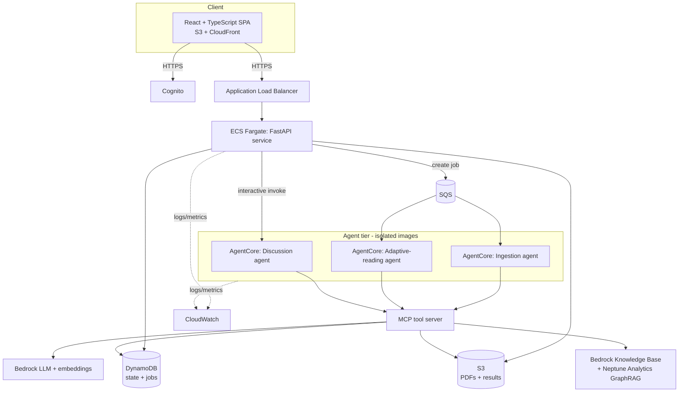

# Architecture

Book Companion turns a large reading commitment into short, meaningful sessions
(≈3/5/10 minutes) while preserving a book's ideas, arguments, and context. It
delivers three capabilities — **adaptive reading**, **GraphRAG discussion**, and
**recommendations** — plus discovery, authorized upload, async jobs, and
progress.

## High level



Region: **`eu-central-1`** (Frankfurt) — a supported region for Bedrock KB
GraphRAG with Neptune Analytics and for AgentCore.

## Three isolated tiers

Isolation is a primary goal: the tiers fail independently and communicate only
across a queue/network boundary — never a shared process.

1. **Application tier** — FastAPI on ECS Fargate. Routing, auth, validation, job
   creation, serving results. Layered `router → service → repository/integration`.
2. **Agent tier** — three LangGraph agents (ingestion, adaptive-reading,
   discussion), each its **own container image** on its **own AgentCore
   Runtime**, so one agent can't crash another and each carries only its own
   dependencies.
3. **Tool tier** — an MCP server exposing an allowlisted set of tools. Agents
   reach AWS/Bedrock only through MCP, so a misbehaving tool is contained.

Boundaries: Application ↔ Agents is **SQS + the DynamoDB job record** (async) or
a direct invoke (discussion); Agents ↔ Tools is **MCP**.

## Why these choices

- **FastAPI + ECS Fargate** (not Lambda-only): multiple API domains, auth,
  validation, OpenAPI, middleware, and local/prod parity benefit from a real
  framework; Fargate removes server management.
- **LangGraph on AgentCore**: multi-step orchestration expressed as graphs;
  deterministic steps stay deterministic (section ranking, word-budget
  allocation, output validation), the model is called only where generation is
  truly needed.
- **MCP tool boundary**: one enforced allowlist; agents can't invoke arbitrary
  AWS APIs.
- **GraphRAG via Bedrock KB + Neptune Analytics**: discussion benefits from
  entity/concept/relationship traversal across a book, not just vector search.
- **Async everywhere expensive**: ingestion and adaptive-reading never block an
  HTTP request — the API returns a `job_id` immediately.

## Key flows

- **Adaptive reading**: `load → budget (150 WPM → 450/750/1500) → rank sections →
  select to budget → generate (model) → validate → attach source refs → store`.
  Coherent condensed prose, not truncation.
- **Discussion**: `retrieve (GraphRAG, user+book scoped) → generate grounded
  answer → citations (from retrieved passages only)`, persisted as a conversation.
- **Ingestion**: `fetch PDF → extract → chunk with chapter/page/source metadata
  → ingest into KB/graph`.

## Security boundaries

- Cognito JWT validated server-side; trusted `user_id` from `sub`; every
  user-owned resource ownership-checked.
- ECS tasks private (no public IPs); ALB is the only public entry, HTTPS only.
- S3 private with public access blocked; short-lived presigned URLs; the PDF
  never flows through the API.
- GraphRAG retrieval scoped to the requesting user; agent tools allowlisted;
  structured model output validated before storage/return.
- Expensive AI endpoints rate-limited per user; job creation idempotent.

See `infrastructure/SECURITY.md` for the full invariant→enforcement audit and
`docs/decisions.md` for the key decisions and their rationale.

## Local development

Local-first: features run against local/mocked AWS. **Local mock mode**
(`docs/local-mock.md`) runs the entire journey in-process with in-memory fakes
and clearly-marked mock AI output — no AWS required.

## Repository map

```
backend/    FastAPI app, agents (3 isolated), MCP server, services, repos, integrations
frontend/   React + TS + Vite + Tailwind SPA
infrastructure/terraform/   networking, ecs, alb, ecr, cognito, storage, database, messaging, ai, observability
docs/       architecture, flow, decisions, local-mock, e2e-validation
.github/    CI/CD workflows
```
